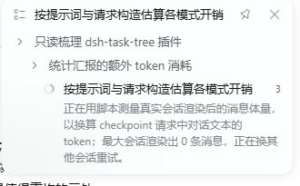

# 任务树 · DSH Task Tree

给 [DeepSeek Harness](https://github.com/deepseek-ai/deepseek-harness)（DSH）的 Web 界面加一棵**会自动延展的任务树**：插件读智能体正在做和已经做过的事，实时生成当前事项、通往它的路径和过程中的设计决策，不需要提前规划。

> 第三方插件，不是 DSH 官方插件。


也可以收进对话右上角的浮窗：



## 安装

装法跟其他第三方插件一样，不需要 DSH 源码 checkout（仓库里已带构建好的 `lib/`）：

- 内网：**插件 → 发现**，搜「任务树」点安装。
- 命令行：`dsh plugin --profile web add git+https://gitlab.deepseek.com/pub/dsh-task-tree.git`
- 公开版：`dsh plugin --profile web add github:std-microblock/dsh-task-tree`

## 使用

装好后输入框上方会出现任务卡片，点开就是当前那条分支：已完成的事项带勾，正在进行的显示细节，决策点一下就插进输入框。

显示位置、生成方式、标题开关都在「插件 → 任务树」里改；要写进 profile 配置的字段见 [docs/config.md](docs/config.md)。

## 开发

开发需要一份已构建的 DSH 源码 checkout，默认与本仓库同级（`../deepseek-harness`）——`devDependencies` 用 `link:` 指向它的各个包：

```sh
pnpm install
pnpm run build
pnpm run typecheck && pnpm test
```

## 已知限制

- 汇报基于最近一次主请求的快照，Turn 里最后一次请求之后的工作要等下一次请求才会被汇报。
- 版本锁定 DSH `0.2.2-alpha.2`（见 `engines.dsh`）。
- 「事项」页靠轮询刷新，滚动同步依赖 DSH Web 的 DOM 属性，DSH 改版后可能需要同步更新。

## 许可

MIT
