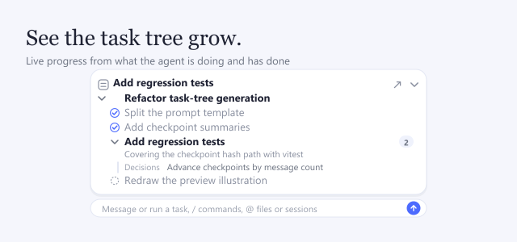

`dsh-task-tree` shows you where a running agent actually is. It never asks the agent to plan ahead: while the agent works, the plugin turns what it is doing and has already done into a task tree — the current task, the path that leads there, what finished, and the design decisions behind it. It is a third-party plugin, not an official DSH plugin, and it follows the approach of kermanx/dsh-progress-check.

## What you see

The card above the composer opens onto the branch the agent is on. Finished items carry a check mark, items the agent has not reached yet show a hollow circle, and untouched branches stay collapsed so the active path is always in view. Item names come from the work itself, so they read like the thing being done rather than a step number. Under the current item a short line says what is happening inside it, and its decisions sit beside it; clicking one inserts it into the composer.

## Where it shows

Keep the tree above the composer, or move it to a floating card in the top-right of the conversation when you want it out of the way. The Tasks page in the sidebar lists recent sessions with their progress and marks the ones with updates you have not seen, and every Turn carries a Task changed row showing where the task moved and which decisions are new.

## What it costs

Each report is one background model call, made only after the agent has finished a few steps and worked for a while. Your own conversation never sees it: the plugin registers no tool and leaves the system prompt alone. If that cost matters, run reports on a cheap model, or on a cheap model with checkpoints, which sends a summary of the older conversation instead of all of it.
