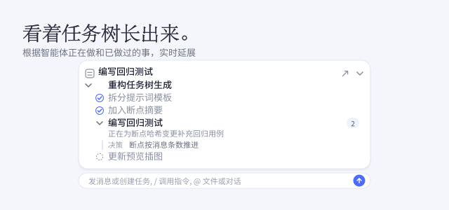

`dsh-task-tree` 让你随时看清智能体做到哪儿了。它不让智能体预先规划，而是在智能体工作时读它正在做和已经做过的事，据此长出一棵任务树：当前事项、通往它的路径、已经完成的部分，以及过程中做出的设计决策。这是第三方插件，不是 DSH 官方插件，参考了 kermanx/dsh-progress-check 的做法。

## 你会看到

输入框上方的卡片展开后，是智能体当前所在的那条分支。做完的事项带对勾，还没开始的显示空心圆，其他分支保持折叠，正在走的那条路径始终可见。事项名字取自工作本身，读起来是「正在做的事」，而不是第几步。当前事项下面有一行说明它内部正在发生什么，旁边的决策点一下就插进输入框。

## 显示位置

任务树可以放在输入框上方，也可以收进对话右上角的浮窗。侧边栏的「事项」页列出最近的会话和各自的进度，有新进展但还没看过的会标红点；每个 Turn 里还有一行「事项变更」，展开能看到事项路径怎么变、新增了哪些决策。

## 开销

每次汇报都是一次后台模型调用，只在智能体又完成了几步、又工作了一段时间之后才发起。你的对话看不到它：插件不注册工具，也不改系统提示。如果在意费用，可以让汇报走廉价模型，或者走「廉价模型 + 断点摘要」，后者只发送旧对话的摘要，而不是全文。
